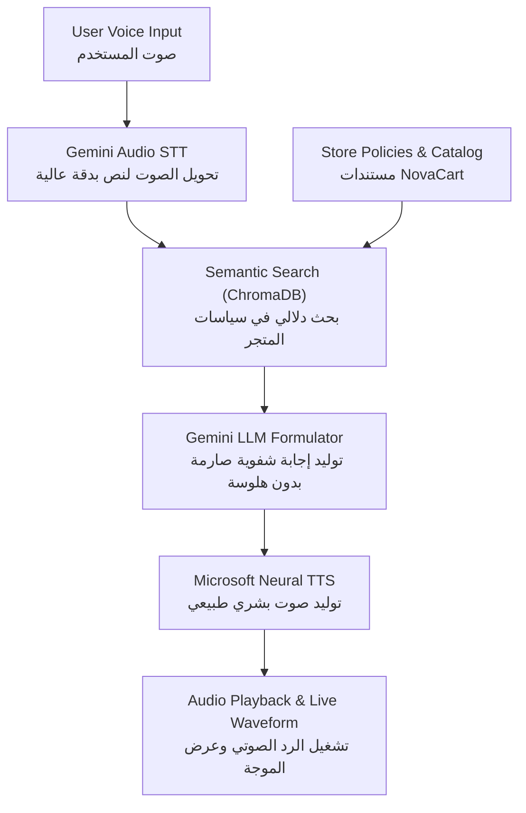

# NovaCart Voice Copilot
### Low-Latency Bilingual AI Voice Assistant for E-Commerce & Subscription Operations
> مساعد ذكي ناطق ومسموع لخدمة عملاء ودعم عمليات التجارة الإلكترونية والاشتراكات باللغتين العربية والإنجليزية.

---

## Live Cloud Demo | التجربة الحية على السحابة

You can try the live interactive Voice Copilot immediately on Streamlit Community Cloud:

**[Launch NovaCart Voice Copilot Live Demo](https://voice-rag-copilot-d7.streamlit.app)**

> جرب المساعد الصوتي مباشرة أونلاين عبر الرابط أعلاه: تحدث عبر المايكروفون واستمع للرد الصوتي الفوري!

---

## What is NovaCart Voice Copilot? | ما هو المساعد الصوتي؟

**NovaCart Voice Copilot** is a next-generation voice AI designed specifically for e-commerce stores and subscription businesses. Instead of frustrating automated telephone menus or robotic text chatbots, customers and operations agents can **speak naturally** using their microphone, and receive an **instant, spoken answer** in human-like voice within **2.5 seconds**.

تم تصميم **NovaCart Voice Copilot** ليكون المساعد الصوتي الأسرع والأدق لشركات التجارة الإلكترونية والاشتراكات. بدلاً من روبوتات المحادثة المعقدة أو قوائم الهاتف الآلية، يستطيع العميل أو موظف الدعم **التحدث بالصوت مباشرة**، ليحصل على **إجابة صوتية منطوقة وفورية** خلال ثوانٍ معدودة.

---

## Key Customer Benefits | أهم المميزات للمستخدم والشركات

| Feature | What It Means for You | الفائدة للعميل والشركة |
| :--- | :--- | :--- |
| **Instant Voice Answers** | Answers back in 2–3 seconds end-to-end. | استجابة فائقة السرعة بدون أي انتظار. |
| **100% Truth-Grounded (Zero Hallucination)** | Answers strictly from your official store policies, plans, and reports. Never invents fake information. | إجابات دقيقة 100% مستخرجة من سياسات الشركة وتقاريرها بدون أي تأليف أو تخمين. |
| **Speaks Egyptian Arabic & English** | Naturally understands and speaks Arabic, English, and mixed business dialect ("Code-Switching" e.g., *Upgrade*, *Refund*, *Pro Plan*). | يتحدث ويفهم العربية المصرية والإنجليزية والمصطلحات المدمجة بسلاسة طبيعية. |
| **Lightweight Cloud-Powered** | No heavy graphics cards (GPUs) needed. Runs anywhere from Streamlit Cloud to a compact Docker container. | يعمل بالكامل عبر السحابة بدون الحاجة لأجهزة باهظة الثمن أو تحميل موديلات ضخمة. |
| **Enterprise Privacy** | Audio is transcribed in real-time memory and never permanently stored without permission. | خصوصية وأمان عالي: معالجة الصوت تتم في الذاكرة دون تخزين تسريبات للمحادثات. |

---

## System Architecture | كيف يعمل النظام تقنياً؟

