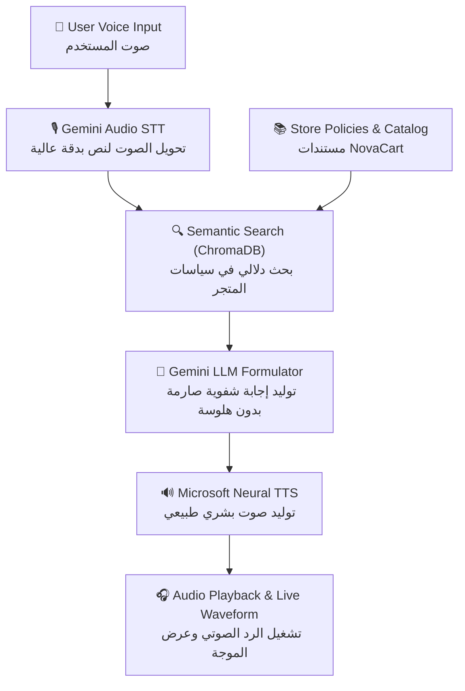

# 🎙️ NovaCart Voice Copilot
### Low-Latency Bilingual AI Voice Assistant for E-Commerce & Subscription Operations
> مساعد ذكي ناطق ومسموع لخدمة عملاء ودعم عمليات التجارة الإلكترونية والاشتراكات باللغتين العربية والإنجليزية.

[](https://voice-rag-copilot-d7.streamlit.app)
[](https://www.python.org/)
[](https://ai.google.dev/)
[](https://www.trychroma.com/)
[](https://fastapi.tiangolo.com/)
[](evaluation/reports/eval_summary.md)

---

## 🌐 Live Cloud Demo | التجربة الحية على السحابة

You can try the live interactive Voice Copilot immediately on Streamlit Community Cloud:

👉 **[Launch NovaCart Voice Copilot Live Demo](https://voice-rag-copilot-d7.streamlit.app)**

> جرب المساعد الصوتي مباشرة أونلاين عبر الرابط أعلاه: تحدث عبر المايكروفون واستمع للرد الصوتي الفوري!

---

## 🌟 What is NovaCart Voice Copilot? | ما هو المساعد الصوتي؟

**NovaCart Voice Copilot** is a next-generation voice AI designed specifically for e-commerce stores and subscription businesses. Instead of frustrating automated telephone menus or robotic text chatbots, customers and operations agents can **speak naturally** using their microphone, and receive an **instant, spoken answer** in human-like voice within **2.5 seconds**.

تم تصميم **NovaCart Voice Copilot** ليكون المساعد الصوتي الأسرع والأدق لشركات التجارة الإلكترونية والاشتراكات. بدلاً من روبوتات المحادثة المعقدة أو قوائم الهاتف الآلية، يستطيع العميل أو موظف الدعم **التحدث بالصوت مباشرة**، ليحصل على **إجابة صوتية منطوقة وفورية** خلال ثوانٍ معدودة.

---

## 💎 Key Customer Benefits | أهم المميزات للمستخدم والشركات

| Feature | What It Means for You | الفائدة للعميل والشركة |
| :--- | :--- | :--- |
| ⚡ **Instant Voice Answers** | Answers back in 2–3 seconds end-to-end. | استجابة فائقة السرعة بدون أي انتظار. |
| 🎯 **100% Truth-Grounded (Zero Hallucination)** | Answers strictly from your official store policies, plans, and reports. Never invents fake information. | إجابات دقيقة 100% مستخرجة من سياسات الشركة وتقاريرها بدون أي تأليف أو تخمين. |
| 🗣️ **Speaks Egyptian Arabic & English** | Naturally understands and speaks Arabic, English, and mixed business dialect ("Code-Switching" e.g., *Upgrade*, *Refund*, *Pro Plan*). | يتحدث ويفهم العربية المصرية والإنجليزية والمصطلحات المدمجة بسلاسة طبيعية. |
| 💻 **Lightweight Cloud-Powered** | No heavy graphics cards (GPUs) needed. Runs anywhere from Streamlit Cloud to a compact Docker container. | يعمل بالكامل عبر السحابة بدون الحاجة لأجهزة باهظة الثمن أو تحميل موديلات ضخمة. |
| 🔒 **Enterprise Privacy** | Audio is transcribed in real-time memory and never permanently stored without permission. | خصوصية وأمان عالي: معالجة الصوت تتم في الذاكرة دون تخزين تسريبات للمحادثات. |

---

## 🗣️ What Can You Ask? | أسئلة يمكن للعميل أو الموظف طرحها

### 🛍️ For Customers | لعملاء المتجر:
* **اشتراكات وتحديثات:** *"لو أنا بدأت الـ Free Trial بتاع الـ Pro Plan ونسيت أعمل Cancel هتحاسبوني بكام؟"*
* **سياسات الاسترجاع:** *"اشتريت سماعة NovaBuds Pro وطلعت Defective، ينفع أرجعها وتخصموا مصاريف؟"*
* **الشحن والتوصيل:** *"هل الشحن مجاني على خطة الـ Basic لو طلبي بـ 75 دولار؟"*
* **الضمان والاستبدال:** *"ساعة NovaWatch S2 باظت بعد شهر، هل الضمان يغطيها؟"*

### 📊 For Operations & Management | لمسؤولي العمليات والإدارة:
* *"What was the Basic plan monthly churn rate in Q3?"*
* *"In Q3 churn report, which offer performed better: 30% discount or 60-day pause?"*
* *"What is the setup fee policy for Enterprise contracts?"*

---

## 🖥️ Choose Your Interface | طريقتان للتجربة والاستخدام

NovaCart Voice Copilot comes with two ready-to-use interfaces:

### 1. 📊 Streamlit Operations Dashboard (Live Online)
* 🌐 **Live URL:** [https://voice-rag-copilot-d7.streamlit.app](https://voice-rag-copilot-d7.streamlit.app)
* Microphone voice recording (`st.audio_input`) with instant neural speech playback.
* Real-time step-by-step latency observability (`STT`, `Search`, `LLM`, `TTS`, and `Total`).
* Full inspection of retrieved document chunks, source files, and cosine similarity scores.

### 2. 🎙️ The Standalone Dark Minimalist Web UI
* An elegant, distraction-free minimalist dark web interface (`http://localhost:8000/assistant/`).
* **Centered Voice Button:** Dark navy blue button with dynamic glowing accent.
* **Live Acoustic Waveform:** Real-time visual canvas wave dancing to your voice and the AI's reply.
* **Instant Subtitle Card:** Shows the transcribed question, verified answer, and official document citations.

---

## 🚀 Quick Start Guide | كيف تبدأ التشغيل؟

### 1. Online Deployment (Streamlit Community Cloud)
The app is live at: **[https://voice-rag-copilot-d7.streamlit.app](https://voice-rag-copilot-d7.streamlit.app)**  
To deploy your own instance, connect your GitHub repository and add your Gemini API key in **App settings -> Secrets**:
```toml
GEMINI_API_KEY = "AIzaSy..."
```

---

### 2. Run with Docker (1-Click Local Production)
```bash
# 1. Clone repository and setup environment
cp .env.example .env
# Put your GEMINI_API_KEY inside .env

# 2. Launch with Docker Compose
docker compose up -d
```
* 🎙️ **Voice Assistant Web UI:** [http://localhost:8000/assistant/](http://localhost:8000/assistant/)
* 📊 **Operations Dashboard:** [http://localhost:8501](http://localhost:8501)
* 🔌 **REST API Documentation:** [http://localhost:8000/docs](http://localhost:8000/docs)

---

### 3. Run Locally with Python
```bash
# Install dependencies
pip install -r requirements.txt

# Run FastAPI and HTML Web Assistant
python -m uvicorn src.api.main:app --reload --port 8000

# (Optional) Run Streamlit Dashboard locally
streamlit run ui/app.py --server.port 8501
```

---

## 🏗️ System Architecture | كيف يعمل النظام تقنياً؟



---

## 📊 Benchmark & Evaluation Results | نتائج التقييم بالأرقام

Evaluated on 18 curated realistic business scenarios (12 in English, 6 in mixed Arabic/English):

| Metric | Target | Result | Status |
| :--- | :---: | :---: | :---: |
| 🎯 **Answer Correctness** | ≥ 85% | **87.22%** | ✅ PASS |
| 🛡️ **Faithfulness (Zero Hallucination)** | ≥ 90% | **97.22%** | ✅ PASS |
| 🔍 **Source Retrieval Hit Rate** | ≥ 90% | **100.0%** | ✅ PASS |
| 🗣️ **Spoken Style (Zero Markdown)** | 100% | **100.0%** | ✅ PASS |

Full detailed report available in [evaluation/reports/eval_summary.md](evaluation/reports/eval_summary.md).

---

## 🔌 Developer REST API | ربط النظام بتطبيقات الموبايل أو الكول سنتر

* `POST /ask-voice`: Upload audio file (`.wav`, `.mp3`, `.webm`) -> receive text transcript, answer, sources, and Base64 audio reply.
* `POST /ask-voice/audio-stream`: Streams binary MP3 audio directly for IVR / telephony integration.
* `POST /ask-text`: Query with plain text and receive spoken response.
* `GET /health`: Health check and collection chunk count inspection.

---

## 🧪 Testing & Verification
```bash
pytest
```
*All 7 unit and integration tests pass with 100% success rate.*

---

## 🛡️ License & Credits
Developed for **NovaCart E-Commerce & Subscription Operations**.  
Built with FastAPI, Google Gemini API, ChromaDB, Edge-TTS, and Streamlit.
